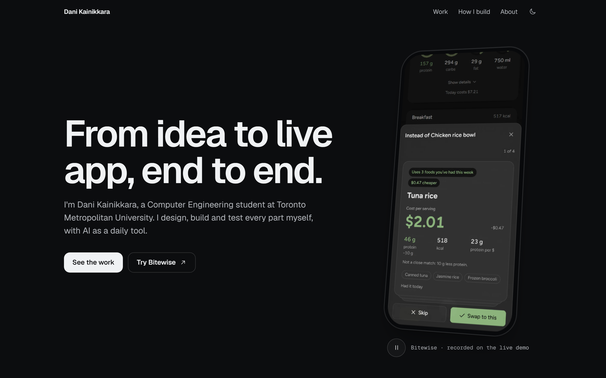

# Dani Kainikkara · Portfolio

A landing page that works like a product launch page, with me as the maker: the apps I've shipped, how I build them, and how to reach me.

**Live:** https://danikainikkara.vercel.app



## What it does

- Opens on a phone playing a real recording of [Bitewise](https://trybitewise.vercel.app), my meal tracker. As you scroll, the phone straightens and stays pinned while four steps explain the app, and its screen changes with each step.
- Shows my work as tiles in each app's own colour: Bitewise, [Ascend](https://ascend-dk.vercel.app) (a habit tracker) and [Orbit](https://orbit-dk.vercel.app) (a CRM for my internship search), each with a live link, a real screenshot, one decision and its test and review counts.
- Walks through how I build with AI: a written plan, read-only reviewer agents before and after the code, and three real bugs they caught.
- Ends on an About section and my email, with a copy button.
- Dark and light themes: it follows your system setting, and a toggle remembers your choice.

## Interesting decisions

- **Numbers are floors with sources.** The page says "900+ unit tests", not "917". Every number in `content/site.ts` keeps the exact count, the date and the file it came from. My repos keep growing, so a floor stays true; a test fails if a floor is ever higher than its count.
- **One phone for the hero and the story.** The phone you see first is the one that walks you through Bitewise. It only pins on windows at least 1024 × 540; on phones the steps stack, each with its own screen.
- **The video plays only when it should.** It plays while it's on screen, not covered by a still, the tab is visible, and you haven't paused it or asked for reduced motion. With Reduce Motion on, it doesn't even download until you press play.
- **No animation library.** The tilt is a CSS scroll-driven animation, the screen changes are CSS crossfades, and reveals are a few lines of IntersectionObserver.

## How I built it with AI

- **Plan first.** [`plans/portfolio.md`](plans/portfolio.md) has every decision and why, and the source of every number.
- **Reviewed before any code.** A read-only logic-checker agent reviewed the plan and found 16 problems (1 critical, 3 high). The critical one: my "How I build" copy claimed more than my own review logs showed. Every finding and its fix is in the plan's Reviews log.
- **Built with the Impeccable design skill**, then reviewed by a code-reviewer, a design-critic (Playwright screenshots at 390 and 1440 px, light and dark) and a finish reviewer. The code-reviewer caught a video that kept decoding after Reduce Motion was turned on, and a theme switch that restarted the video from 0. The agents are in [`.claude/agents/`](.claude/agents).
- **Tested.** 52 unit tests (contrast of every text colour in both themes read from the CSS, the content rules, the scroll logic) and 19 Playwright checks (axe at both sizes and themes, links, Reduce Motion, the theme toggle, the 404 page, and the video in real Chrome: plays, pauses under a still, keeps its place across a theme switch).

## Stack

Next.js 16 (App Router, fully static) · React 19 · TypeScript · Tailwind CSS 4 · Vitest · Playwright + axe · Vercel

## Run it locally

```bash
npm install
npm run dev          # http://localhost:3000
```

No environment variables are needed. On Vercel, `VERCEL_PROJECT_PRODUCTION_URL` (set automatically) gives the link previews their absolute address.

## Tests

```bash
npm test             # Vitest: unit tests
npm run test:e2e     # Playwright: smoke, video (needs Google Chrome) and screenshots; starts the dev server on port 3417
npm run screens      # screenshots only, into docs/screenshots/latest/
npx tsc --noEmit && npx eslint
```
