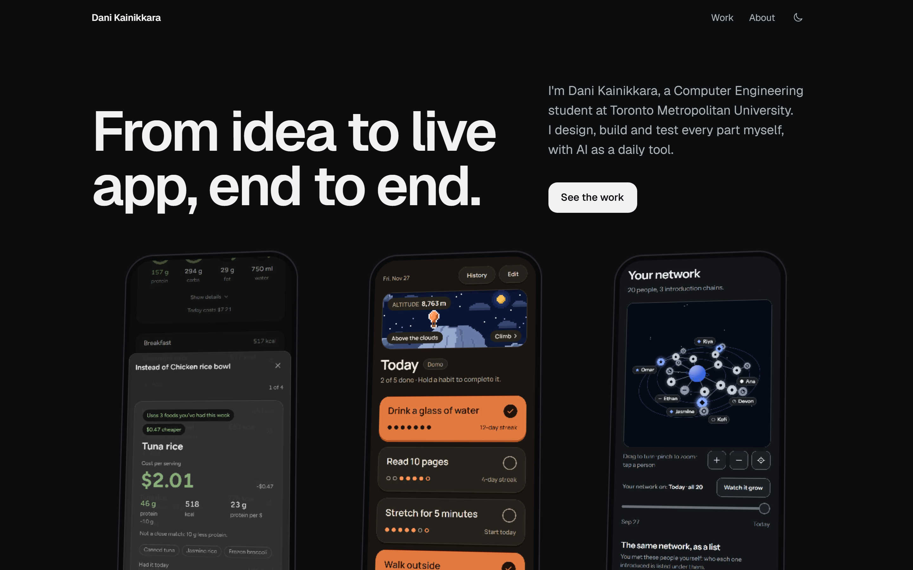

# Dani Kainikkara · Portfolio

A landing page that works like a product launch page, with me as the maker: the three apps I've shipped, and how to reach me.

**Live:** https://danikainikkara.vercel.app



## What it does

- Opens on three phones side by side, each playing a real recording of one of my apps: [Bitewise](https://trybitewise.vercel.app) (a meal tracker), [Ascend](https://ascend-dk.vercel.app) (a habit tracker) and [Orbit](https://orbit-dk.vercel.app) (a CRM for my internship search). On a phone they're a row you swipe.
- Shows the three apps as equal tiles in each app's own colour, each with a live link, one decision, its test and review counts, and a screenshot of a screen the recording above doesn't feature. **Demo video** plays the app's full tour right on the page, in a phone-shaped player. Bitewise also has a [case study](https://danikainikkara.vercel.app/work/bitewise).
- Ends on an About section and my email, with a copy button.
- Dark and light themes: it follows your system setting, and a toggle remembers your choice.

## Interesting decisions

- **Numbers are floors with sources.** The page says "900+ unit tests", not "917". Every number in `content/site.ts` keeps the exact count, the date and the file it came from. My repos keep growing, so a floor stays true; a test fails if a floor is ever higher than its count.
- **Three apps, no favourite.** The same phone, tile and Demo video for each, in the same order everywhere.
- **The videos play only when they should.** A loop plays while it's on screen, the tab is visible, no Demo video is open, and you haven't paused it or asked for reduced motion. With Reduce Motion on, nothing downloads until you press play. On a phone only the loop you've swiped to loads, and a full tour loads only when you open it.
- **No animation library.** The tilt and the dialog's fade are CSS, and reveals are a few lines of IntersectionObserver.

## How I built it with AI

- **Plan first.** [`plans/portfolio.md`](plans/portfolio.md) has every decision and why, and the source of every number.
- **Reviewed before any code.** A read-only logic-checker agent reviewed the plan and found 16 problems (1 critical, 3 high). The critical one: my "How I build" copy claimed more than my own review logs showed. Every finding and its fix is in the plan's Reviews log.
- **Built with the Impeccable design skill**, then reviewed by a code-reviewer, a design-critic (Playwright screenshots at 390 and 1440 px, light and dark) and a finish reviewer. The code-reviewer caught a video that kept decoding after Reduce Motion was turned on, and a theme switch that restarted the video from 0. The agents are in [`.claude/agents/`](.claude/agents).
- **Tested.** 53 unit tests (contrast of every text colour in both themes read from the CSS, the content rules, every video file in place) and 66 Playwright checks (axe at both sizes and themes, links, Reduce Motion, the theme toggle, the 404 page, the Demo video dialog's keyboard and focus, and the videos in real Chrome: they play, pause, keep their place across a theme switch, load only when seen and loop back to their start).

## Stack

Next.js 16 (App Router, fully static) · React 19 · TypeScript · Tailwind CSS 4 · Vitest · Playwright + axe · Vercel

## Run it locally

```bash
npm install
npm run dev          # http://localhost:3000
```

No environment variables are needed. On Vercel, `VERCEL_PROJECT_PRODUCTION_URL` (set automatically) gives the link previews their absolute address.

## Tests

```bash
npm test             # Vitest: unit tests
npm run test:e2e     # Playwright: smoke, video (needs Google Chrome) and screenshots; starts the dev server on port 3417
npm run screens      # screenshots only, into docs/screenshots/latest/
npx tsc --noEmit && npx eslint
```
